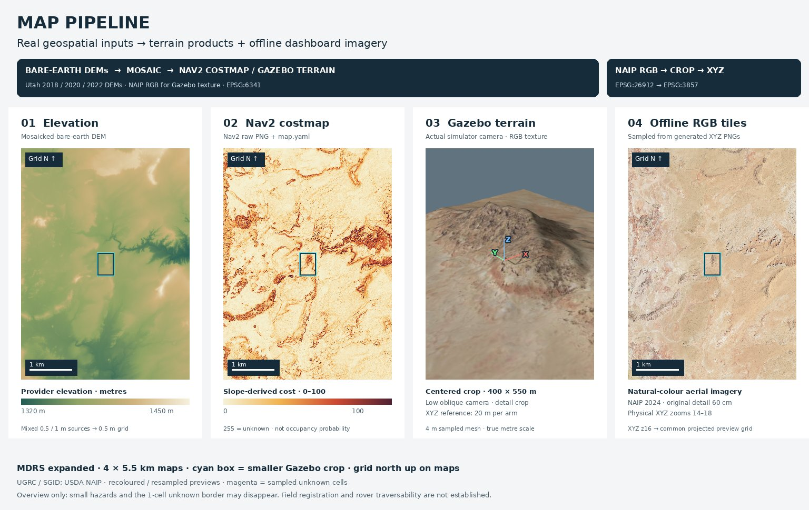

# Map Pipeline

Reproducible offline map generation for the MR2 rover: elevation to Nav2
costmaps, RGB imagery to dashboard tiles, and elevation + RGB to Gazebo terrain.



*Real `mdrs-expanded` outputs, reduced for illustration. Sources: UGRC/SGID and
USDA NAIP; cropped, reprojected, sampled and recoloured. See
[preview provenance, legends and data terms](docs/images/README.md).*

Repository: **[URC-kaist/map-pipeline](https://github.com/URC-kaist/map-pipeline)**.
Version: `0.1.0-dev`. The code license is intentionally [undecided](CODE-LICENSE.md).

This project supersedes [URC-kaist/lidar](https://github.com/URC-kaist/lidar).
That repository is retained as a read-only development archive for the original
LiDAR processing experiments. Use this repository for current procedures.

The current profile covers **4 × 5.5 km**, including the requested operating
rectangle and a 500 m northern extension. See [expanded coverage](docs/EXPANDED-COVERAGE.md)
for source priorities, mixed resolution, limitations and validation.
The operating coordinates are specified in **URC 2027 rule 1.e.xiii**; the
coverage document includes the supplied rule excerpt and distinguishes the
approximate competition area from our additional margin.

## Outputs at a glance

The repository supports three workflows, sharing source preparation and the
explicit map footprint:

| Workflow | Implementation | Main artifacts |
| --- | --- | --- |
| **Elevation → Nav2 costmap** | [Lidar-pipeline/pipeline.py](Lidar-pipeline/README.md) | `occupancy.png` + `map.yaml`, DEM/features, metadata and manifest |
| **RGB → offline tile map** | [RGB-pipeline/generate.py and serve.py](RGB-pipeline/README.md) | `site/tiles/naip/{z}/{x}/{y}.png`, tile metadata and local HTTP server |
| **Elevation + RGB → Gazebo terrain** | [Lidar-pipeline/export_gazebo.py](docs/GAZEBO.md) | Textured OBJ/MTL/PNG, collision STL, model/world SDF and frame/provenance manifest |

| Preview | Product and workflow |
| --- | --- |
| [Elevation](docs/images/elevation.png) | Mosaicked DEM, with a 0.5 m output grid and mixed 0.5/1 m source detail. |
| [Nav2 costmap](docs/images/nav2-costmap.png) | Colour-mapped preview of the real raw cost PNG: 0–100 costs, 255 unknown. A configured terrain product, not proof of rover traversability. |
| [Gazebo terrain](docs/images/gazebo-terrain.jpg) / [camera frame](docs/images/gazebo-camera.jpg) | [Simulation workflow](docs/GAZEBO.md): actual Gazebo render of a centered 400 × 550 m crop, with georeferenced RGB texture, OBJ visual and STL collision. |
| [Offline RGB](docs/images/rgb-tiles.jpg) | [RGB processing and serving](RGB-pipeline/README.md), physical XYZ zooms 14–18. This preview samples actual tiles; it is not a dashboard integration screenshot. |

The elevation, costmap and RGB previews share a 4 × 5.5 km footprint, with grid
north up. Cyan outlines mark the smaller Gazebo crop. Reduced preview
resolution hides small features and may hide the one-cell unknown border.
The common presentation does not establish field registration; DEM, source RGB,
Web Mercator tiles and local Nav2 poses retain their distinct coordinate contracts
described below. [Capture and regeneration notes](docs/images/README.md) identify
the real outputs and processing settings.

## Quickstart

Install the [supported environment](ENVIRONMENT.md). All commands below run
from this repository root. Choose the workflow(s) you need.

### Shared source preparation

```bash
/usr/bin/python3 download_sources.py
/usr/bin/python3 prepare_sources.py
/usr/bin/python3 mosaic_dem.py
```

### 1. Elevation → Nav2 costmap

```bash
/usr/bin/python3 Lidar-pipeline/pipeline.py --output Lidar-pipeline/output/mdrs-expanded
```

Use the matched `occupancy.png` and `map.yaml` with the generated coordinate
metadata. The display preview is not a navigation input.

### 2. RGB → offline tile map

```bash
/usr/bin/python3 RGB-pipeline/generate.py
/usr/bin/python3 RGB-pipeline/serve.py
```

RGB uses the DEM mosaic's footprint; it does not require costmap generation.
The server runs until Ctrl-C. MapLibre is an optional viewer, described below.

### 3. Elevation + RGB → Gazebo terrain

After workflow 1 has produced the DEM and coordinate metadata:

```bash
/usr/bin/python3 Lidar-pipeline/export_gazebo.py \
  Lidar-pipeline/output/mdrs-expanded \
  --output Lidar-pipeline/output/mdrs-gazebo-relief \
  --texture RGB/q3128_se_NAIP2024_RGB.tif RGB/q3129_sw_NAIP2024_RGB.tif
ign gazebo -r Lidar-pipeline/output/mdrs-gazebo-relief/world.sdf
```

Export needs no simulator. Viewing requires the optional Gazebo environment.
The default simulation is a centered 400 × 550 m crop at true metric scale.
It uses the original georeferenced RGB TIFFs, not the tile server or MapLibre.
See [Gazebo capture, collision checks and frame mapping](docs/GAZEBO.md).

The source downloader uses public HTTPS URLs and verifies SHA-256. Manual
portal downloads are an alternative, subject to the same checksums. See
[source provenance and conditions](docs/SOURCES.md) and [sources.json](sources.json).
Generation is offline once the source archives have been obtained.

Choose new output directories to repeat generation; existing results are never
overwritten. The RGB server serves the generated `site/` tree on localhost:8088,
including `/tiles/naip/{z}/{x}/{y}.png`. **Node and MapLibre are not required to
generate tiles, produce metadata, or serve these files.**

## Optional visualization demo

Prepare any MapLibre GL JS package separately, then add its local assets:

```bash
/usr/bin/python3 RGB-pipeline/build_viewer.py RGB-pipeline/output/mdrs-expanded --assets /path/to/maplibre-gl-package
```

This package must include `dist/maplibre-gl.js`, `dist/maplibre-gl.css`,
`package.json` and `LICENSE.txt`. For example, prepare MapLibre 4.7.1 in a
separate tools directory using `npm pack maplibre-gl@4.7.1` and extract that
package there. Alternatively, download the package tarball with curl from
`https://registry.npmjs.org/maplibre-gl/-/maplibre-gl-4.7.1.tgz`; Node/npm are
not required to serve browser assets. It is an optional acquisition step, not part of map conversion.
The demo was tested with 4.7.1; `mr2-stack/node_modules` is just one possible
local asset source and is no longer hardcoded or necessary.

With the optional viewer built, open http://127.0.0.1:8088/ for the graphical
map. Without it, tile/metadata HTTP requests still work and `/` lists files.
The demo's assets are bundled locally so no Internet is needed for viewing.

## Workflows and coordinate contracts

- [Terrain pipeline](Lidar-pipeline/README.md): explicit projection/bounds/anchor,
  Horn slopes, validity masks, raw-mode Nav2 map and optional simulation meshes.
- [Gazebo terrain](docs/GAZEBO.md): centered metric crop, georeferenced RGB
  texture, model/world packaging, real camera capture and collision smoke check.
- [RGB pipeline](RGB-pipeline/README.md): crop to the DEM outer footprint,
  EPSG:3857, north-origin XYZ, 256 px PNGs, physical zooms 14–18.
- [Environment and tests](ENVIRONMENT.md): core versus optional dependencies.
- [Release status](RELEASE-REVIEW.md): what has been verified and what remains.

The DEM uses NAD83(2011)/UTM 12N (EPSG:6341); RGB uses NAD83/UTM 12N
(EPSG:26912). They are transformed, not relabeled. Web Mercator tiles and a
Nav2 local map frame are different coordinate systems. Runtime map poses reach
geographic dashboard overlays via the robot's `/toLL` transform. Source datum
operations available here are approximate; field registration is not established.

Nav2 PNGs use raw values 0–100 and 255 unknown with a matched YAML and new metadata
schema. They are not a drop-in replacement for the old mr2-stack scale-mode
cropper. Dashboard integration requires maxzoom 18, generated bounds and correct
same-origin tile routing. Its rendering choice is tracked in
[issue #82](https://github.com/URC-kaist/mr2-stack/issues/82).

## Repository layout and data policy

```text
sources.json, download_sources.py, prepare_sources.py
mosaic_dem.py
Lidar/                  # Original DEM ZIPs/extractions/mosaic, ignored
RGB/                    # Original imagery ZIP/extraction, ignored
Lidar-pipeline/          # Shared DEM/mesh code; Nav2 and Gazebo workflows
  pipeline.py           # Elevation → features + Nav2 raw PNG/YAML
  export_mesh.py        # Reusable OBJ/STL + georeferenced texture export
  export_gazebo.py      # Elevation + RGB → cropped terrain model/world
  capture_gazebo.py     # Optional simulator camera capture
  verify_gazebo.py      # Optional simulator collision smoke check
  output/               # Generated Nav2/Gazebo artifacts, ignored
    mdrs-expanded/      # DEM, occupancy.png, map.yaml, metadata/manifest
    mdrs-gazebo-relief/  # world.sdf, model/, cropped DEM, gazebo.json
RGB-pipeline/            # Processing, static server and optional demo
  generate.py, serve.py  # RGB → XYZ tiles; local HTTP serving
  build_viewer.py        # The only generation step requiring MapLibre assets
  output/               # Generated tiles/site/intermediates, ignored
docs/                   # Source metadata, history and release evidence
  GAZEBO.md             # Gazebo generation, import, capture and checks
  images/               # Selected compact previews + provenance only
  prepare_previews.py   # Assemble poster from retained real outputs
tests/                  # Small synthetic integration checks
```

No original data was deleted during cleanup. History is archived in
[workspace-history.md](docs/workspace-history.md); those notes retain their
original machine/session context and are not fresh-install instructions.
Historical evidence is separate from current manifests and test reports.

## Verification

```bash
make test
```

Small synthetic checks need no source downloads or Node installation. Optional
PDAL/legacy-code comparisons skip when their inputs/dependencies are absent.
Real-data checks, optional browser checks, native Nav2 decoding and past
implementation findings are described in the workflow READMEs. The [initial GitHub CI run](https://github.com/URC-kaist/map-pipeline/actions/runs/43455153377)
passed after publication. Source-data terms and third-party licenses remain
separate from the undecided code license.
